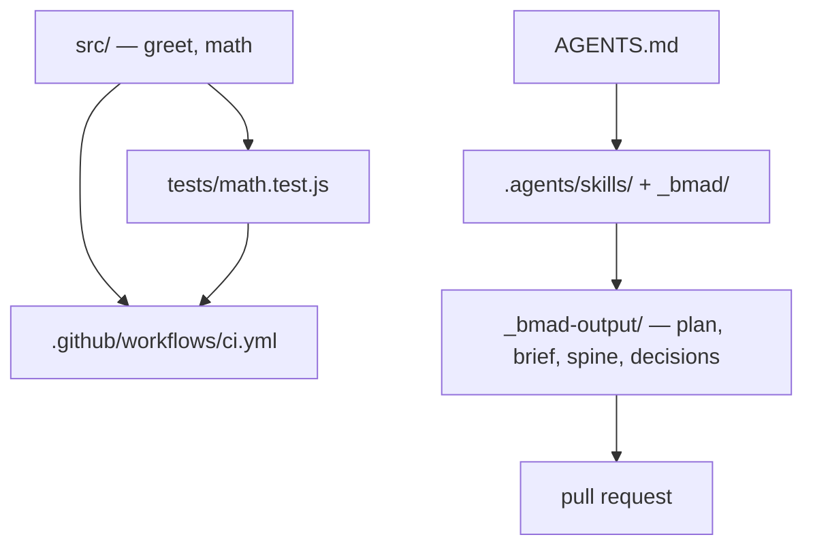

# Architecture Spine — repo-alpha

## Design Paradigm

Layered, with an explicit method layer on top. The implementation layer owns behavior, the
assertion layer owns the proof, the gate layer decides whether a change may land, and the method
layer (`.agents/skills/`, `_bmad/`) turns a request into a plan and the plan into records under
`_bmad-output/`. A layer may only depend on the one it sits above; nothing depends back.

## Invariants & Rules

### AD-1 — The suite finalizes last

- **Binds:** `tests/math.test.js`
- **Prevents:** a run that reports success while later assertions never executed
- **Rule:** the summary print and the exit-code decision stay at the end of the file; no code
  above the final assertion may finalize the run.

### AD-2 — CI executes the whole suite

- **Binds:** `.github/workflows/ci.yml`
- **Prevents:** green checks that never ran the code under change
- **Rule:** every pull request's CI includes a job that runs `npm test`; the greet-only jobs stay
  as they are, but they never stand in for the suite.

### AD-3 — Exports live in the final `module.exports`

- **Binds:** `src/math.js`
- **Prevents:** a function that exists in the file but is not exported to callers
- **Rule:** a new math function is added to the last `module.exports` declaration of the file.

### AD-4 — A change ships with its plan and evidence

- **Binds:** every pull request opened from this repository
- **Prevents:** a change nobody can check against the reasoning that produced it
- **Rule:** the plan and its evidence live under `_bmad-output/` and are committed with the change.

### AD-5 — The owner approves and merges

- **Binds:** every change in this repository
- **Prevents:** an author grading its own work and an agent merging
- **Rule:** no implementation starts before the owner approves the plan, and no agent merges.

### AD-6 — `node_modules/` is vendored

- **Binds:** `node_modules/`
- **Prevents:** edits to committed dependencies that no install step would reproduce
- **Rule:** never edit files under `node_modules/`; change the dependency or the code that uses it.

## Consistency Conventions

| Concern | Convention |
|---|---|
| Assertions | Hand-written `assertEqual` in `tests/math.test.js`; `jest` is a devDependency but unused |
| Failure reporting | Print `FAIL:` with expected and actual, then count the failure |
| Exit semantics | Set `process.exitCode = 1`; never call `process.exit()`, which truncates output on a pipe (introduced with pull request #67) |
| Dependencies | None new — the library is plain Node with no runtime dependencies |
| Planning artifacts | `_bmad-output/<kind>-<slug>/<kind>-<slug>.md`, one folder per artifact |
| Skills | `.agents/skills/`, pinned by `skills-lock.json`; BMAD scripts and config under `_bmad/` |
| Agent instructions | `AGENTS.md`, managed block refreshed by the `bmad-project-context` skill |

## Deferred

- Splitting `src/math.js` into modules — no pressure yet, one file still reads as one list.
- A real test framework — the hand-written suite is the current standard, and changing it is a
  decision with its own evidence, not a side effect of another change.
- Any user interface — the fixture has none.

## Open questions

- Whether the `lint` and `test` CI jobs, which only check `greet`, should be renamed to say so;
  they mislead readers who expect `test` to be the suite.
